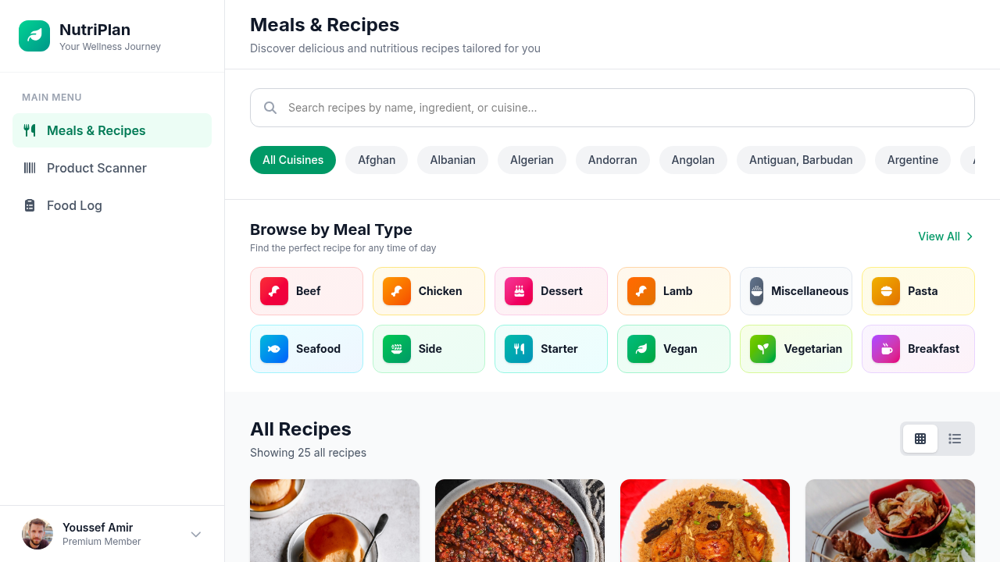

# NutriPlan - Food, Nutrition & Fitness Planner

A nutrition and recipe planner: search meals, explore categories and cuisines, check nutrition breakdowns, log what you eat and follow your week on a chart.

**Live demo:** https://yosef-tamer206.github.io/NutriPlan/



## Features

- Recipe search with instant (debounced) results
- Browse by category and by cuisine/area
- Meal details with ingredients and an embedded YouTube tutorial
- Nutrition analysis per recipe, with per-serving breakdown
- Daily food log with calorie and macro totals, saved in the browser
- Weekly progress chart (Plotly)
- Packaged products section with barcode lookup and product categories
- Friendly dialogs and warnings (SweetAlert2)

## Tech Stack

- HTML5, CSS3, JavaScript (ES modules, class-based API layer)
- Tailwind CSS (browser build)
- Plotly.js for charts
- SweetAlert2 for dialogs
- `localStorage` for the food log
- Meal, nutrition and product data served by a hosted training API (`nutriplan-api.vercel.app`)

## Run Locally

```bash
git clone https://github.com/Yosef-Tamer206/NutriPlan.git
cd NutriPlan
```

Serve the folder with any static server (ES modules require http, not `file://`), for example:

```bash
npx serve .
```

Then open the shown local URL.

## Notes

- The food log lives in your browser's `localStorage`; clearing browser data resets it.
- Recipe and product data come from a shared training API, so availability depends on that service.
